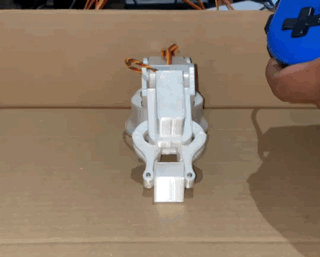

# SG90 ARM Control Platform (LeRobot Teleoperator Integration)

## Overview
This project provides a Flask-based web interface and gamepad teleoperation system for a 4-DOF SG90 robot arm, with ESP32 firmware and full LeRobot compatibility. It enables real-time control, dataset recording, and easy integration with the LeRobot open-source robotics library.

---

## Features
- **Web UI**: Control the arm via sliders or enable/disable joints, set and go to home positions.
- **Gamepad Teleoperation**: Plug-and-play support for USB gamepads (hardcoded mapping, deadzone filtering for stick drift). Most controllers will work if they follow the standard mapping (see `flask_control/app.py`).
- **LeRobot Teleoperator**: Python class exposes joint angles in LeRobot format for use in experiments and demos.
- **Dataset Recording**: Record joint angles and timestamps to a `.pkl` file in LeRobot dataset format with a single button.
- **ESP32 Firmware**: Real-time servo control and smooth motion for the SG90 arm.

---

## Directory Structure
- `flask_control/` — Flask app, gamepad logic, LeRobot teleop class, templates
- `src/main.cpp` — ESP32 firmware for SG90 arm
- `platformio.ini` — PlatformIO config for ESP32
- `test_lerobot_teleop.py` — LeRobot teleop test script
- `arm_demo.pkl` — Example dataset (after recording)

---

## How It Works
### 1. Flask Web Server & UI
- Start the server: `python3 -m flask_control`
- Open your browser to `http://localhost:5000`
- Use the web UI to control the arm, enable/disable joints, set home positions, and record datasets.

### 2. Gamepad Teleoperation
- Plug in your USB gamepad.
- The mapping is hardcoded for reliability (see `flask_control/app.py`):
  - **Base (J1):** Left Stick L/R (Axis 0)
  - **Shoulder (J2):** Left Stick U/D (Axis 1)
  - **Elbow (J3):** Right Stick U/D (Axis 5)
  - **Gripper (J4):** X/A/Square button toggles open/close
- Deadzone filtering prevents stick drift from moving the arm unintentionally.

### 3. LeRobot Integration
- The `WebGamepadTeleop` class in `flask_control/webgamepad_teleop.py` exposes the current joint angles in the format LeRobot expects.
- Example usage:
  ```python
  from lerobot import load_teleoperator
  teleop = load_teleoperator("WebGamepadTeleop")
  print(teleop.get_action())
  ```
- See `test_lerobot_teleop.py` for a demo script.

### 4. Dataset Recording
- Click the **Record** button in the web UI to start logging joint angles and timestamps.
- Click again to stop and save as `arm_demo.pkl`.
- The file is compatible with LeRobot’s data utilities:
  ```python
  import pickle
  data = pickle.load(open("arm_demo.pkl", "rb"))
  print(data['angles'], data['timestamps'])
  ```

---

## ESP32 Firmware Setup & Flashing
### Hardware Requirements
- ESP32 development board (tested with ESP32 DevKit v1)
- 4x SG90 servos (or compatible)
- External 5V power supply for servos (recommended)
- Robot arm assembled from [chipcode's model](https://www.printables.com/model/567401-4-dof-robot-arm-sg90)

### Firmware Flashing
1. Install [PlatformIO](https://platformio.org/) (VSCode extension or CLI).
2. Connect your ESP32 via USB.
3. Clone this repo and open the project folder.
4. Edit `platformio.ini` if your ESP32 board is different.
5. Build and upload the firmware:
   ```bash
   pio run -t upload
   ```
6. The ESP32 will receive joint angle commands from the Flask server and control the servos in real time.

### Why LEDC Instead of Servo.h?
- **Servo.h** is not well-supported on ESP32 and can cause jitter or timing issues with multiple servos.
- **LEDC** (ESP32's hardware PWM) provides precise, smooth, and simultaneous control of all 4 servos.
- The firmware uses direct LEDC PWM channels for each servo, ensuring reliable and flicker-free motion.

### PID & Motion Smoothing
- Each servo is controlled with a simple PID loop to minimize overshoot and oscillation.
- The target angle is updated in real time; the firmware applies a mathematical smoothing function:
  ```cpp
  // Pseudocode for smoothing
  error = target_angle - current_angle;
  output = Kp * error + Kd * (error - last_error);
  current_angle += output * dt;
  // Clamp to servo limits
  ```
- PID constants (`Kp`, `Kd`) are tuned for each joint for smooth, responsive movement.
- This approach avoids abrupt jumps and extends servo lifespan.

---

## Challenges & Solutions
- **Gamepad Axis Mapping**: Hardcoded the mapping and scaling for reliability.
- **Stick Drift**: Added a deadzone filter (±10 around center) to prevent unwanted arm movement.
- **Dataset Recording**: Designed a robust backend and UI for synchronized angle/timestamp logging, ensuring compatibility with LeRobot.
- **Code/Repo Cleanliness**: Removed all dev, cache, and template files for a clean, submission-ready repository.

---

## Demo



---

## Credits & Attribution
- **SG90 Arm Model**: The 3D model and mechanical design are by [chipcode (@Carl_110408)](https://www.printables.com/social/346634-carl_110408) and licensed under [Creative Commons 4.0 International (CC BY 4.0)](https://creativecommons.org/licenses/by/4.0/). This project uses and builds upon their work for the hackathon.
- **Software, Integration, and Refinement**: [Ashalen](https://github.com/Ashalen) (project author) — Flask control, gamepad teleop, LeRobot integration, dataset recording, and all code refinements.

---

## License & Attribution
- **SG90 Arm Model**: Open source under [Creative Commons 4.0 International (CC BY 4.0)](https://creativecommons.org/licenses/by/4.0/). You are free to use, remix, and build upon the model for any purpose (including hackathons and commercial use) as long as you provide attribution to [chipcode (@Carl_110408)](https://www.printables.com/social/346634-carl_110408).
- **This Project**: Created for the 2025 hackathon by [Ashalen](https://github.com/Ashalen). All code is open source under the MIT License (see `LICENSE`).
- **Attribution**: This project builds on the work of chipcode and is not affiliated with the original model author. Please credit both authors if you reuse or remix this project.

---

## Project Status & Future Plans
- **Hackathon Origin**: This robot and software platform were created for the 2025 Lerobot Worldwide hackathon to demonstrate open, affordable robotics.
- **Ongoing Support**: The project will be maintained and improved, with bugfixes and new features based on community feedback.
- **Upgrades**: Planned upgrades include new gripper designs, improved firmware, and support for additional sensors.
- **CAD Models**: New CAD files for grippers and arm upgrades will be released as open source.
- **Contributions**: Pull requests and suggestions are welcome!

---

## Acknowledgements
- Thanks to the LeRobot team and the open source robotics community for inspiration and support.

